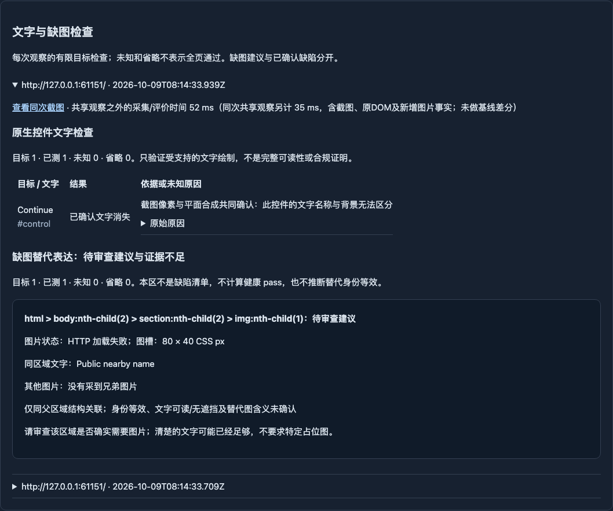

# 文字与缺图检查的普通扫描接线

已开启的网址扫描自动执行限定文字规则并生成缺图审查材料。工作台输入网址和可选目标即可，无需实验 CLI、语义合同或额外实验开关。全局网址模式仍默认关闭。API 使用 `POST /api/runs` 的 ui-scan 请求。

## 普通用户如何使用

在**原本已经开启网址扫描**的部署上，照常打开工作台，选择“网址 UI 检查”，填写网址，可选填检查目标，点击“开始检查”。结果中的“文字与缺图检查”直接展示：

- 原生控件的文字、定位、限定 pass/fail/unknown/not-applicable、可读原因和同次截图；受支持的 D005 fail 也进入原已确认缺陷清单。
- 独立的“缺图替代表达：待审查建议与证据不足”区域，包含图片状态、图槽尺寸、同区域文字、兄弟图片及关联限制。不要求用户打开 JSON，也不把建议放进缺陷清单。
- 每次观察的目标数、已采集记录数（界面“已测”，包含 unknown）、unknown 和省略数。未知/省略不是全部通过；旧观察可展开，新观察显示在前。

API 示例（服务地址由部署提供）：

```sh
curl -X POST "$UI_SENTINEL_URL/api/runs" \
  -H 'Content-Type: application/json' \
  -d '{"kind":"ui-scan","entryUrl":"https://example.org/page"}'
```

这是使用示例，本轮没有访问 example.org。已有的 `goal`、权限、范围与预算参数保持不变；可选目标仍由原扫描流程解释，本轮没有要求用户提供 CSS selector。API 报告增加 `uiRules` 历史投影，原 findings/inspection 语义不变。重新打开 `/?run=<runId>` 即恢复同一报告材料。

本轮**没有全局设置 EXECUTION_URL_SCAN**。两项仅由已开启的 ui-scan 执行器自动调用；全局注册器中的 D005 默认仍关闭，业务模式既有规则不变，D004和其他候选未启用。这是本轮明确授权的产品接入，不是主项目已上线的声明。



## 实际接线位置与事实生命周期

| 位置 | 实际行为 |
| --- | --- |
| [executor.ts](../../src/execution/executor.ts)，`if (uiScan)`、约1356行 | 导航前安装 `createUiRuleObservation` 与被动图片请求记录；仅 ui-scan 开启既有图片资源监听，业务分支不进入。 |
| 同文件 `performObservation/captureCurrent`，约1058行 | 在原正式观察前后读取有界事实，把图片 selector 合入同一次 observePage，使用同一 screenshot/snapshot。原 recapture/观察复用机制保留。 |
| 同文件 `performChecks`，约690行 | 调用已有 D005 factory/cache，将结果交回原 rule:evaluated、findings、检查台账路径。R005 不成为 RuleResult 或缺陷。 |
| [ui-rule-observation.ts](../../src/execution/ui-rule-observation.ts) | 只适配事实生命周期，直接复用原 `readBatch2Facts`、`screenshotInk`、`createControlTextDisappearanceRule`、`reviewImageFallbacks`；没有重写规则算法或放宽支持范围。 |
| [run-report.ts](../../src/server/reports/run-report.ts)、[ui-rule-report.ts](../../src/server/reports/ui-rule-report.ts) | 从已持久化事件/同run artifacts 恢复报告，验证正文和同次截图摘要及关联证据可读性；材料丢失/改变时显示证据不足，不重新推断结论。 |
| [main.tsx](../../src/web/main.tsx)、[ui-rule-report.tsx](../../src/web/ui-rule-report.tsx) | 普通 ui-scan 报告直接挂载可读分区；无实验页或专用审批流程。 |

每次正式观察至多枚举16个原生 button/a[href]、16个 img；D005保留1024个元素/64层祖先/单文字矩形100,000像素预算；被动图片请求元数据最多256条，现有资源字节预算保持。省略和超预算明确保留，不能据剩余目标推算全页。

两项共享被检查网页的浏览器、同次截图和普通 DOM/imagePaint。文字像素解码复用既有方法：在同一浏览器的隔离、拒绝网络上下文读取已保存截图，随后关闭；不是重开浏览器、额外访问网站或重拍整页。图片采集只读取正常浏览器已取得的响应，不补抓、不重放业务动作、不增加模型调用。

收据绑定 run/page/viewport、document/node、DOM epoch、截图和观察时间。评价前再次比对有界当前事实，过期/目标/资源/样式/页面变化拒绝旧事实；每次新观察重置适配器结果缓存。同一收据只有重新核对事实和完整性后才可标为重复结果。图片/动态页面仍按原观察复用机制保守处理。

稳定清洁证据下的已知绘制范围限制，使用现有 `unchecked` 能力边界表达并记录 unsupported；不是制造 pass 或修改完成门。网络干预、变化、真实执行/持久故障不享受该豁免，沿用原停止/未知契约。检查器仍可能报告部分 unknown，报告明确列出，不让模型为了“凑适用率”无限重试。本轮没有适用率准入门槛，也没有改 R0 sampling/完成门。

## 结论与支持范围保持

D005 仍为 `control-text-disappearance` 0.1.0：受支持、稳定、唯一、启用的原生纯文字控件，只有平面合成及截图共同证明文字消失才 fail；黑白文字像素是有限健康 pass。描边、阴影、圆角、复杂背景、伪元素、自定义字体、非支持颜色、歧义和不完整证据仍 unknown；正常禁用等明确例外仍不适用。无需为普通原生文字手填语义合同，但不扩张为完整可读性/WCAG判断。

R005 仍为 `image-fallback-review` 0.1.0 非Rule审查材料：loaded、loading、lazy未观察到请求、source-absent、HTTP/请求/解码失败按原语义显示。实际同区域文字、图片和布局只有结构关联；身份等效、文字可读无遮挡和替代图含义仍未知。缺头像、空槽和不用特定占位不自动 fail，不生成健康 pass；没有 native img 的实体仍无法枚举。

完整算法和正常反例沿用 [第二批历史交付](rules-batch2.md) 及其8项证据，本轮未重跑这些算法场景。新接入不覆盖全部广义知识、原 Jira 或公网可用率。


## 维护与验证

当前默认状态见[知识库首页](README.md)，异常与健康反例见[靶场](../counterexample-arena.md)。历史原始 JSON 保存在[证据目录](evidence)，不将旧结果当作新构建重跑。
